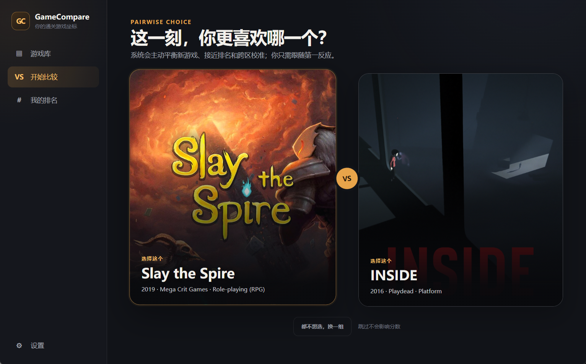
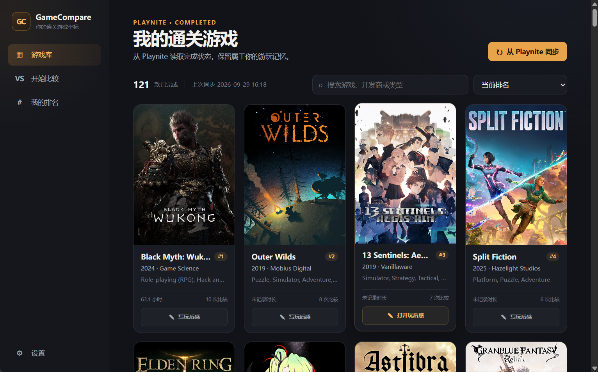
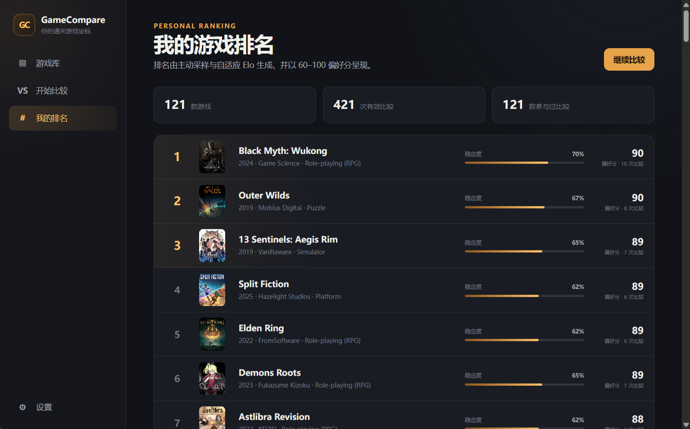

# GameCompare

一个读取本地 [Playnite](https://playnite.link) 游戏库、通过两两比较生成个人游戏排名的 Windows 桌面应用，可以为每款游戏关联 [Obsidian](https://obsidian.md) 玩后感笔记。



## 它是怎么工作的

你不需要给任何游戏打分。GameCompare 一次展示两款已通关的游戏，问你"这一刻更喜欢哪一个"；积累选择之后，程序用自适应 Elo 算法从这些两两比较中推算出你的个人排名。

1. 从 Playnite **只读**导入标记为 `Completed` 的游戏
2. 不断进行左右二选一（或跳过）
3. 查看个人排名（以 60–100 的偏好分展示）
4. 随时为任意游戏创建或打开 Obsidian 玩后感

## 功能特性

- **Playnite 同步**：自动探测 Playnite 数据目录，一键导入 `Completed` 游戏及封面、开发商、平台、类型、游玩时间等元数据；游戏移出 `Completed` 后只是移出活动列表，历史比较记录完整保留
- **偏好比较**：配对算法按 60% 精排 / 25% 覆盖 / 15% 跨区校准主动采样，优先安排最能收敛排名的组合；"跳过"不计入分数
- **个人排名**：自适应 K 值的 Elo 算法，新游戏收敛快、成熟排名波动小；每次有效选择都保存为不可变的原始记录，将来更换排名算法也无需重新比较
- **Obsidian 玩后感**：在设置中选择 Vault 与笔记子目录（默认 `GameCompare/Games`）后，从游戏卡片一键创建带模板的 Markdown 笔记并交给 Obsidian 打开；通过 `playnite_id` 稳定关联，笔记移动后仍能重新找到，已有笔记正文永远不会被覆盖





## 安装

### 系统要求

- Windows 10 1809 及以上，或 Windows 11
- [Playnite](https://playnite.link) 10（本地游戏库）
- （可选）[Obsidian](https://obsidian.md)：使用玩后感功能需要，且 Windows 上至少启动过一次以注册 `obsidian://` 协议
- WebView2 Runtime：较新的 Windows 10 和 Windows 11 一般已内置

### 下载

从 [Releases](../../releases) 页面下载最新的 `GameCompare.exe`（自包含单文件，无需另装 .NET 运行时），双击即可运行。

## 快速上手

1. **同步游戏库**：首次启动后在"设置"中确认 Playnite 数据目录（默认自动探测），回到游戏库点击"从 Playnite 同步"。同步前请完全关闭 Playnite。
2. **开始比较**：进入"开始比较"页，凭第一反应点选更喜欢的一侧；记不清就点"都不想选，换一组"。
3. **查看排名**："我的排名"页随时展示当前名次、偏好分和稳定程度，比较越多排名越收敛。
4. **写玩后感**（可选）："设置 → Obsidian 玩后感"中选择 Vault 根目录和笔记子目录，然后在游戏卡片上点"写玩后感"。

## 数据与隐私

本地优先，无云服务、无遥测、无账号：

- 所有数据保存在 `%LocalAppData%\GameCompare`（`gamecompare.db` 与 `settings.json`），删除该目录即彻底清除
- 对 Playnite 数据库只读，通过临时快照读取，绝不写回（详见 [SECURITY.md](SECURITY.md)）
- 只在 Vault 内指定的笔记子目录创建新文件，从不修改已有笔记正文

## 从源码构建

需要 .NET 10 SDK：

```powershell
dotnet restore GameCompare.sln
dotnet run --project src\GameCompare.App\GameCompare.App.csproj
```

运行测试：

```powershell
dotnet test GameCompare.sln
```

生成自包含单文件 exe：

```powershell
dotnet publish src\GameCompare.App -c Release -r win-x64 --self-contained -p:PublishSingleFile=true
```

## 许可证

[MIT](LICENSE)
